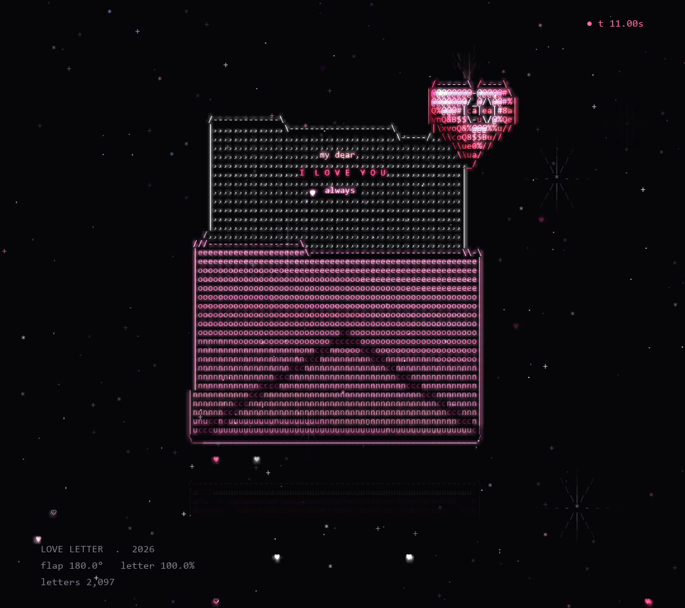

# LOVE LETTER

A pink envelope is drawn in by a point of light and a heart-shaped wax seal pops onto
it. The flap swings open, the seal floats up and starts to beat, and a letter slides out
of the envelope with a burst of tiny hearts. Then the message types itself onto the paper:

```
my dear,
I  L O V E  Y O U
♥  always  ♥
```



## How to run

```bash
pip install numpy pygame-ce
python letter.py
```

Save one frame without opening a window (here at t = 11 s):

```bash
python letter.py --shot 11 letter.png
```

| Key | Action |
|---|---|
| `SPACE` | Pause / resume |
| `R` | Restart |
| `S` | Save a screenshot |
| `ESC` | Quit |

Needs `../ascii_engine.py` (keep it in the main folder).

## What happens

| Time | Moment |
|---|---|
| 0 - 2.5 s | The envelope is drawn in by light |
| 2.6 s | The heart seal pops on |
| 3.8 - 5.4 s | The flap swings open and the seal floats up |
| 5 - 7.5 s | The letter slides out, with a burst of hearts |
| 8 s + | The message types itself, and the seal beats above the letter |

## Write your own letter

Change `MESSAGE` at the top of `letter.py`. Each line has its text and colour:

```python
MESSAGE = [("dear Sam,", (200, 140, 160)),
           ("HAPPY BIRTHDAY", (255, 70, 120)),
           (E.HEART + "  love you  " + E.HEART, (255, 150, 190))]
```

Keep each line under about 45 characters so it fits on the paper.
`EW` and `EH` set the envelope's width and height.

## How it works

- The envelope front is a flat panel with darker fold lines. The flap is a triangle
  hinged on the top edge that rotates in 3D, so it swings toward you as it opens.
- The seal is a small puffy 3D heart that follows the flap, lifts off, then beats.
- The paper uses a faint character set (`. , : ;`) so the typed message stands out.
- Rendering comes from the shared `ascii_engine.py`.

---

Made with ♥ by **Aavi** · [GitHub @awnish9002](https://github.com/awnish9002) ·
[Instagram @code_with_aavi](https://www.instagram.com/code_with_aavi/) ·
[All pieces](../README.md)
